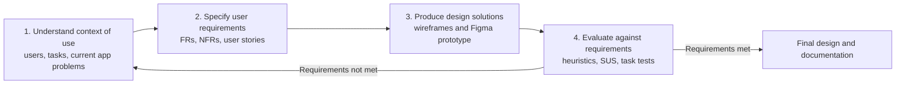

# Technology Brief: User Experience (UX) Design

> UX falls under Option 6 of the technology table in the assignment brief, which needs lecturer approval by the end of Week 4. Confirm approval with Dr. Faiz and keep the evidence.

## C1. Fundamental Concepts

### What it is

User Experience (UX) design is the practice of shaping how people interact with a product so that it is useful, usable and satisfying. UX is wider than UI: the UI (user interface) is the visible layer (screens, buttons, colours, text), while UX covers the whole experience, including whether the person can actually achieve their goal quickly, with few errors, and with confidence.

### Key concepts

| Concept | Meaning | Example in this project |
|---------|---------|-------------------------|
| Usability | How effectively, efficiently and satisfactorily users reach their goals | Time and taps needed to buy an item |
| Human-centred design | Designing around real users' needs, tested with them | Testing the prototype with 5 users |
| Information architecture | How content and functions are organised and labelled | Where filters and seller information are placed |
| Interaction design | How the system responds to user actions | What happens when a user taps "Place bid" |
| Visual design | Layout, typography, colour and spacing | Making the total price easy to find |
| Accessibility | Design that people with different abilities can use | Contrast ratio, touch target size, text resizing |
| Prototyping | An interactive model used for testing before building | A clickable Figma prototype |
| Usability testing | Observing users while they perform realistic tasks | Measuring task time and SUS score |

### How it works at a basic level

UX design follows an iterative cycle. This project follows the human-centred design activities from ISO 9241-210: understand the context of use, specify requirements, produce design solutions, then evaluate them against the requirements, and repeat until the design meets them.

*Figure 1. Human-centred design cycle used in this project (adapted by the author from ISO 9241-210).*

## C2. Frameworks, Models, Methods and Tools

| # | Item | Type | What it is used for in this project |
|---|------|------|--------------------------------------|
| 1 | Nielsen's 10 Usability Heuristics | Evaluation method | Review the current app screens against 10 general principles (for example visibility of system status, error prevention, consistency and standards, recognition rather than recall). The findings feed the problem evidence and the design decisions. |
| 2 | ISO 9241-210 human-centred design process | Process model | Provides the iterative cycle (Figure 1) that structures the project from context analysis to evaluation. |
| 3 | System Usability Scale (SUS) | Measurement instrument | A 10-question questionnaire that gives a score from 0 to 100 after a user test. Used to check NFR1. |
| 4 | WCAG 2.2 | Accessibility standard | Gives measurable rules such as the 4.5:1 minimum text contrast (used for NFR3) and text resizing support. |
| 5 | Figma | Design and prototyping tool | Used to create wireframes, a reusable component library and a clickable prototype for testing. |
| 6 | Material Design 3 or Apple Human Interface Guidelines | Platform design guidelines | Provide platform-standard components and touch target guidance (for example 48 dp in Material Design) so the redesign feels native. Choose the one that matches your chosen platform. |

## C3. Fit to the Problem

### How UX design addresses the problem

The problem is not missing features. It is that buyers struggle to find, compare and trust information in the current interface. UX methods target exactly this:

1. Heuristic evaluation and task walkthroughs identify where the interface causes friction.
2. Requirements and user stories turn those findings into testable design goals.
3. Prototyping lets the redesign be tested cheaply before any development effort.
4. Usability testing and SUS give measurable evidence on whether the redesign improved the experience.

### Benefits

- Directly targets the observed problems (clarity, trust, effort) rather than adding features.
- Low cost: a prototype needs no backend, real data or app-store release.
- Measurable: tap counts, task times and SUS scores allow before-and-after comparison.
- Accessibility improvements benefit all users, not only those with impairments.

### Limitations and risks

1. **Small, non-representative sample.** A test with about 5 participants finds many usability problems but cannot prove how the design would perform with all eBay users, so results are indicative only.
2. **Prototype is not the real product.** A prototype cannot measure real-world outcomes such as conversion rate, actual load time or behaviour with real money, and it does not account for eBay's technical and business constraints.
3. **Limited access to eBay's own data.** Without eBay's analytics and research, the problem evidence comes from observation and public reviews, which may be incomplete or subjective.
4. **Designer bias.** The same person designs and evaluates the redesign, so findings can be biased. Using standard heuristics and a measured instrument (SUS) reduces this risk.

### Comparison with one alternative: machine-learning personalisation

| Aspect | UX redesign (chosen) | ML-based personalisation / recommendation |
|--------|----------------------|-------------------------------------------|
| Targets | Clarity, effort and trust in the interface | Relevance of the items shown |
| Data needed | Small user-research sample | Large volumes of user behaviour data (privacy-sensitive) |
| Cost and effort | Low (prototype only) | High (data pipeline, model training, evaluation) |
| Risk | Small sample size | Bias, privacy concerns, "filter bubble" |
| Fit to this project | Strong | Weak, because the problem is about interface clarity, not item relevance |

### Choice and reason

I choose UX redesign. The identified problem is about how information is presented and how many steps the buyer must take, which a better interface can fix directly. ML personalisation would need data I do not have access to and would not fix an unclear price or checkout screen.

Sources for this brief are listed in [research-sources.md](research-sources.md).
